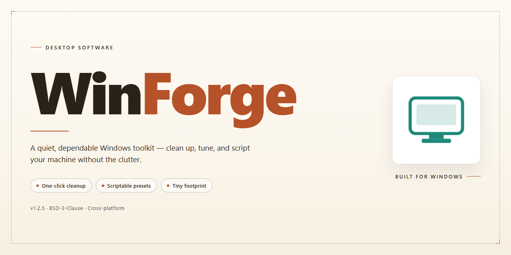

# ⚙️ WinForge Windows Tool: Modular System Utility & Automation Suite Windows 10 & 11

### ⚡ PowerShell Setup Button

   

---

WinForge is a desktop optimization and system management tool Windows that unifies live monitoring, per-game tuning, and deep OS configuration within a single native application. The core engine applies per-process rules CPU and GPU priority, I/O priority, power plans, and core affinity, then automatically reverts system state when a monitored game session ends. A time sensor layer exposes temperatures, voltages, clocks, and memory telemetry grouped by device, while an in-game overlay surfaces FPS and frame-time metrics without leaving the rendered application. Extensibility is handled through a modular component system in which optional modules—such as timer resolution, USB polling-rate tuning, fan curves, and process management—are installed, updated, or removed independently of the core binary.

## 📋 System Requirements

- **OS:** Windows 10 / 11
- **Shell:** PowerShell 5.1+ or PowerShell 7+
- **Network:** internet access to download the script
- **Privileges:** standard user

## Features

WinForge consolidates live system monitoring, in-game optimization, game management and Windows tuning into a single desktop application built gamers and power users. Every optimization feature is available at no, with no usage limits or feature gating.

- **Game Mode automation.** Detects when a game launches and applies a defined optimization profile automatically — process priority, service trimming and power plan switching — then restores the previous system state when the game exits, leaving no residual configuration behind.

- **Game library with per-title rules.** Discovers installed titles across Steam, Epic, GOG, Xbox and other launchers, as well as emulators. Each game can carry its own rule set covering CPU and GPU priority, I/O priority, power plan, core affinity, Windows Defender exclusion and Flow Guard, all configured from a single properties panel.

- **Live monitoring and sensor telemetry.** time readings CPU, memory, network, temperatures, voltages and clocks, grouped by device and expandable by category. An in-game metrics overlay surfaces performance data during play and is bound to keyboard shortcuts.

- **Core and power management.** Power plan selection, turbo ceiling configuration (boost and performance limits) with Default and Recommended profiles, per-core affinity assignment and per-core monitoring.

- **Centralized Windows tuning hub.** A single interface hosting hundreds of individual tweaks across ten categories — privacy, power,, updates, notifications, sound, Explorer, startup, taskbar and theme — with a recommended baseline profile and ready-made presets. The same hub provides advanced TCP and network configuration, debloat routines, system repair, Windows Update, device cleanup and startup management.

- **Installable component architecture.** Core sections ship with the application; additional capabilities are installed, updated or removed from within the Workshop catalog. Available components include timer resolution tuning, USB polling rate overclocking, keyboard repeat and filter configuration, automatic RAM cache cleanup, PWM fan curves per channel with selectable temperature, a system process manager, stability stress tests, macro recording and playback, a configurable autoclicker and a 3D scene benchmark. Shared driver dependencies are managed independently from a dedicated Drivers page, so they remain visible and maintainable even when the components that use them are removed.

- **Integrated toolset.** Macros, autoclicker, cache and registry cleanup, DNS configuration, power plan management and system repair utilities are accessible without leaving the application.

- **Multilingual interface.** Twenty languages, shipped with the application or installed as language packs.

- **Self-contained deployment.** The installer requires no separate.NET or Windows App SDK runtime, and the application updates itself from within its own Settings interface. Builds are produced automatically from the project.

## How it works

WinForge operates as a single elevated process that coordinates three subsystems: a telemetry layer, a rules engine, and a system configuration provider. Understanding how these interact explains what the tool does and why it behaves the way it does.

**Telemetry and monitoring layer**

At startup the application enumerates through the Windows performance counter interface and, where available, low-level driver bridges sensors that do not expose readings through standard APIs. Readings are polled on configurable intervals and pushed to an internal event bus. The UI subscribes to this bus rather than polling the directly, so every panel — dashboard, per-core monitor, in-game overlay — consumes the same synchronized sample set. In-game metrics are rendered by a separate lightweight overlay process that receives frame timing data from a hook attached to the foreground game window; the hook is attached only while an overlay session is active and detaches cleanly on exit.

**Game detection and session lifecycle**

The game library is built by scanning known launcher installation paths and their manifest files at launch and on manual refresh. Detected titles are matched against a local compatibility database that maps executables to per-game rule templates. When a process matching a library entry starts, the session manager transitions into Game Mode: it captures a snapshot of the current system state, then applies the configured rule set — process and I/O priority, CPU affinity, power plan, and any exclusion or mitigation flags. On process exit, the snapshot is restored in reverse order of application. All state changes are journaled locally so that an unclean shutdown can be reconciled on the next launch.

**Optimization engine**

The tuning hub is a declarative catalog. Each entry describes a target (registry key, service, scheduled task, or policy), the values it can take, its default, and its risk classification. Applying a tweak validates the target against the current system build before writing, records the previous value, and supports single-step revert. Presets and the recommended profile are simply ordered sets of catalog entries, which is why applying and reverting them is deterministic. Network, debloat, repair, and update operations follow the same pattern: preview, apply, journal, and expose a rollback path.

**Extensible components**

Core sections are loaded directly; installable components are resolved through the Workshop at runtime. Each component declares its dependencies, including shared driver bridges. The dependency resolver checks the presence and version of each dependency before activation, installs or repairs it on request, and keeps it registered independently of the components that reference it. Removing a component does not remove a shared dependency still required elsewhere; uninstalling a dependency is an explicit, separate action.

**Persistence and updates**

Configuration, per-game rules, and the change journal are stored in a local application data directory. The updater checks the channel defined in settings, downloads the package, verifies its signature, and applies it on the next launch to avoid interrupting an active session.

## Compatibility

WinForge runs on 64-bit Windows only. The following matrix defines the supported configurations and clarifies where functionality is expected, conditional, or degraded.

| Platform | Status | Notes |
|-|-|-|
| Windows 11 25H2 (x64) | Fully supported | Primary validation target all releases. |
| Windows 11 24H2 (x64) | Fully supported | Full feature set; same runtime behavior as the primary target. |
| Windows 11 23H2 and earlier (x64) | Supported | Core features verified. Some OS-specific tweaks may be absent or behave differently depending on build availability. |
| Windows 10 22H2 (x64) | Supported | Core features verified. Certain optimizations tied to Windows 11 services or components are not advertised on this OS. |
| Windows 10 earlier builds (x64) | Limited | Best-effort operation. Individual tweaks and components may be unavailable; install components on demand rather than applying broad presets. |
| Windows on ARM (ARM64) | Not supported | No native build is offered; behavior is untested and unsupported. |
| 32-bit Windows | Not supported | The application targets x64 only. |

**Architecture.** WinForge requires a 64-bit processor and operating system. The installer is self-contained and does not depend on the.NET runtime or the Windows App SDK being present on the machine; no separate framework installation is required.

**Privileges.** The application elevates on launch, as most optimization features modify system settings. Features that touch machine-wide state — power plans, service and process tuning, network parameters, startup entries, and driver-backed components — require the elevated context and are unavailable or read-only without it.

**Component-specific requirements.** Compatibility is also determined per installable component:

- **Sensor monitor and Fans** — CPU temperature, clock, and power readings, and PWM fan, require the PawnIO driver. Without it, the sensor monitor continues to display readings that do not depend on the driver; fan curves and driver-backed sensors are disabled until PawnIO is installed from Settings → Drivers.
- **USB overclocking** — depends on the hidusbf driver, shared across components and managed from Settings → Drivers. Devices or controllers that do not support polling-rate adjustment are reported as unsupported rather than being modified.
- **Timer resolution, Key filter, Memory, Process management, Macros, Autoclicker, Stability test** — depend on standard Windows facilities and apply without additional drivers; availability of individual options follows the API support of the installed Windows build.
- **Metrics overlay and 3D scene benchmark** — in development. They are offered as preview functionality and are not part of the compatibility guarantee the current release.

**Per-game rule coverage.** Game Mode and per-game rules apply to processes launched after the app is running and are reverted when the game exits. Coverage of launcher detection (Steam, Epic, GOG, Xbox, and other launchers, plus emulators) is verified across supported platforms, but rules that rely on OS-specific facilities — such as Flow Guard and Windows Defender exclusions — appear only on builds where those facilities exist.

**Tweaks across OS builds.** The optimization catalog is curated against the supported platforms. A tweak that is not applicable to the installed build of Windows is not presented as available; where a tweak exists in a different form or not at all, WinForge omits it rather than issuing a no-op. Recommended profiles and presets are evaluated against the current OS before application.

**Runtime behavior.** System-level changes are applied through documented Windows APIs and settings providers, and reversible operations are tracked so that Game Mode and profile changes can be reverted cleanly. Behavior on configurations outside the matrix above is not validated and should be considered unsupported.

## FAQ

**Is WinForge really free?**

Yes. Every optimization feature is completely free, with no limits, no premium tier and no feature gated behind a payment. The full tuning hub, Game Mode, per-game rules, monitoring and the Workshop components are all available to every user.

**Does WinForge require administrator rights?**

Yes. WinForge elevates on launch because it modifies system-level settings: power plans, process and I/O priorities, core affinity, services, the registry and driver-backed sensors. Without elevation those changes cannot be applied or reverted reliably.

**Which Windows versions are supported?**

Windows 10 and Windows 11, x64 only. The current build is tested on Windows 11 25H2. The installer is self-contained and does not require a separate.NET or Windows App SDK runtime.

**How does Game Mode work?**

Game Mode watches a game process to start, then applies the configured optimization set automatically — process priorities, services and power plan. When the game process exits, every change is reverted to its previous state, so nothing stays applied outside the session.

**How are games detected?**

The game library scans installed titles from Steam, Epic, GOG, Xbox and other launchers, and also detects emulators. Each detected title can carry its own rule set: CPU and GPU priority, I/O priority, power plan, core affinity, Windows Defender exclusion and Flow Guard.

**What is the Workshop?**

The Workshop is the catalog of everything WinForge can do. It contains the core sections that ship with the app plus optional components you can install, update or remove from inside the application — among them timer resolution, USB overclocking, key filter, memory cleanup, sensor monitor, fans, process management, stability test and macros. Installing or removing a component does not require reinstalling the app.

**Why do the sensor monitor and fans ask a driver?**

CPU temperature, clock and power readings, as well as PWM fan, are exposed through the PawnIO driver. While that driver is not installed, the affected pages show a notice pointing to Settings → Drivers and continue to display every reading that does not depend on it. PawnIO and hidusbf (used by USB overclocking) are shared dependencies, so they are managed permanently in Settings → Drivers and can be installed, repaired or uninstalled there independently of the components that use them.

**How many tweaks does the optimization hub include?**

418 tweaks across 10 categories: privacy, power,, updates, notifications, sound, Explorer, startup, taskbar and theme. The hub ships with a recommended profile and ready-made presets, and the same section hosts the advanced TCP/Network, Debloat, Tools and features, Windows panel, Repair, Windows Update, Device cleanup and Startup management pages.

**How are updates delivered?**

WinForge updates itself from Settings → Updates. Every release is built in CI from the in the repository, so the distributed binary matches the published code.

**Does WinForge support languages other than English?**

Yes. 20 languages ship with the app or are installed as language packs, selectable from the settings.

**Can changes be undone?**

Yes. Game Mode reverts its changes when the game closes, individual tweaks in the optimization hub can be toggled back, and the Repair section provides system-level recovery actions settings that need to be restored.

## Disclaimer

WinForge is provided as-is, without warranty of any kind, express or implied. The system-level modifications it performs — power plan changes, registry tweaks across the tuning hub, process and service adjustments, core affinity and priority settings, driver-backed sensor and fan, USB polling rate changes, and timer resolution overrides — carry inherent risk. All modifications are applied locally on the target machine and are intended use in a configuration you own,, and can restore from a known-good state.

Administrator elevation is required at launch because WinForge writes to protected system areas. Users are responsible verifying that each applied tweak is appropriate their and workload before enabling it. The Recommended profile and ready-made presets are provided as starting configurations, not as guarantees of stability or performance on every system. Where a component depends on the PawnIO driver or hidusbf, functionality that relies on that driver is unavailable until it is installed, and WinForge will surface that state rather than silently substituting a fallback.

Component availability is tracked per component, and not all components are at the same stage: some are installable, some downloadable, and some still in development. Features marked in development may change, behave inconsistently, or be removed between releases. The stability test and benchmark components report measurements only; results are not a score and should not be treated as a certification of system health.

WinForge distributes its software only through its official distribution channel. Builds obtained from any other are not supported, may have been modified, and should not be used. Verify you are running an official release before applying any system modification. Every release is built from the project's in its continuous integration pipeline.

This software is released under the MIT License, which governs its use, reproduction, and distribution. The full terms, including the limitation of liability, apply alongside this notice. If you do not accept these terms, do not run the application.

## License

WinForge Windows Tool is distributed under the MIT License, a permissive - license that grants full freedom to use, copy, modify, merge, publish, distribute, sublicense, and sell copies of the software. The complete license text is bundled with the tree in the repository root and accompanies every official build artifact.

Under the terms of the MIT License, any copy or substantial portion of the software must retain the original copyright notice and this permission notice. The software is provided "as is", without warranty of any kind, express or implied, including but not limited to the warranties of merchantability, fitness a particular purpose, and non-infringement. In no event shall the authors or copyright holders be liable any claim, damages, or other liability arising from, out of, or in connection with the software or its use.

Because WinForge Windows Tool performs system-level modifications — including service configuration, power plan adjustments, registry tuning, and driver-dependent sensor and fan — redistribution of modified builds is permitted under the license but is not supported by the project. Only official releases are covered by the compatibility guarantees described in the Compatibility section and by the safety guidance in the Disclaimer section. Modified copies should be clearly identified as unofficial and must not imply endorsement by the project maintainers.

Third-party components referenced or bundled by WinForge Windows Tool remain under their respective licenses. Shared dependencies used by installable components are governed by their own terms and are documented alongside the component metadata in the Workshop catalog and in the Drivers settings page. Users installing those components are responsible reviewing the applicable licenses before deployment.

The MIT License applies uniformly across all core sections and installable components published by the project. No additional restrictions, royalty obligations, or attribution requirements beyond those stated in the MIT License are imposed on downstream users or integrators.